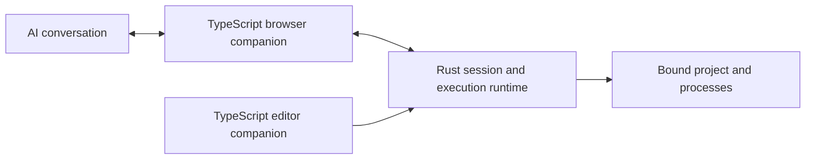

# Relay

**Your editor owns the workspace. Your web AI does the coding.**

Relay binds an AI conversation to a specific local project. The agent can inspect code, edit files and run checks, with readable activity and verified execution receipts.

[Download v1](https://github.com/RiprLutuk/relay/releases/latest) · [Setup](#setup) · [Verification](docs/verification.md) · [Configuration](docs/configuration.md)

## Setup

The VSIX includes the editor extension, Rust runtime and browser companion. You do not need to clone this repo, select a binary or run `relayctl start`.

Download the package matching your OS and processor:

| OS | Download |
| --- | --- |
| Windows | [x64](https://github.com/RiprLutuk/relay/releases/download/v1.0.0/relay-workspace-1.0.0-win32-x64.vsix) |
| Linux | [x64](https://github.com/RiprLutuk/relay/releases/download/v1.0.0/relay-workspace-1.0.0-linux-x64.vsix) · [ARM64](https://github.com/RiprLutuk/relay/releases/download/v1.0.0/relay-workspace-1.0.0-linux-arm64.vsix) |
| macOS | [Intel](https://github.com/RiprLutuk/relay/releases/download/v1.0.0/relay-workspace-1.0.0-darwin-x64.vsix) · [Apple Silicon](https://github.com/RiprLutuk/relay/releases/download/v1.0.0/relay-workspace-1.0.0-darwin-arm64.vsix) |

Windows/Linux packages are cross-built; direct editor integration tests were run on macOS. See [verification](docs/verification.md).

1. In VS Code or Cursor, open **Extensions → ⋯ → Install from VSIX…** and select your download. Open a local project folder you trust. Relay starts automatically.
2. Open the Command Palette (**Ctrl+Shift+P**, or **Cmd+Shift+P** on macOS). Run **Relay: Open Browser Extensions** to reveal the prepared browser companion folder.
3. Open your browser's extensions page: `chrome://extensions`, `brave://extensions` or `edge://extensions`. Enable **Developer mode**, click **Load unpacked** and select the folder revealed in step 2. Pin Relay to the browser toolbar.
4. In the editor, run **Relay: Copy Pairing Token**. Click Relay in the browser toolbar, paste into **Pairing token from your editor** and click **Pair editor**. Pairing is saved.
5. Open a Claude or ChatGPT conversation and its Relay popup. Select **Project**, choose **Access for this conversation** and click **Start session**. Then type your task in chat normally.

The popup should show **Ready** and list your project before you start. Ready confirms the connection; starting a session enables agent actions for that chat. Full access also requires checking its approval box.

Start attaches Relay to an already-open chat if its agent is missing. A failed startup stays visible as **Session failed** with its error message.

Try: **“List the main folders in this project and explain what it does.”** Actions and results appear in the chat; recent activity also appears in the popup and **Relay: Open Control Center**.

## Daily use

Open your project and AI conversation, select the project in Relay and start a session. Use **Stop session** before choosing another project. Each conversation keeps its selected root even when editor focus changes. Browser pairing and unpacked installation are one-time steps.

<details>
<summary>Updating or still seeing version 4.0.6?</summary>

Install the v1 VSIX manually and confirm replacement: the reset version sequence means v1 is numerically lower than the development 4.x builds. Run **Developer: Reload Window**, then close and reopen the Relay extension details tab. Reload Relay on the browser's extensions page and refresh the AI tab before starting a new session.

The extension details page should show **1.0.0**. The old instructions asking you to select `relayctl` belong to a development build. See [update configuration](docs/configuration.md#updates) if an incompatible runtime is still running.

</details>

## What makes a session reliable

- **Explicit targets:** every editor window registers every open folder. A conversation keeps its chosen root; focus changes cannot redirect it.
- **Scoped access:** Workspace mode confines files and commands. Full access requires approval for that conversation.
- **Execution receipts:** retries with the same operation identity reuse the result. Different payloads cannot reuse that identity.
- **Visible lifecycle:** waiting, executing, returning, paused and failed are separate states. A connection alone does not mean the agent is running.
- **Cancellation:** closing the owning workspace invalidates its sessions and cancels running processes.

Claude was verified live for file creation and read-back in Brave on macOS. ChatGPT is covered by the browser integration fixture. Profiles also exist for Gemini, DeepSeek, Kimi, GLM, Qwen, Arena, Meta AI, Ptero and Grok; see the [tested scope](docs/verification.md).

## Architecture



Application source is **TypeScript + Rust**. JavaScript under `build/` and `out/` is generated. Files use kebab-case, functions use camelCase and types use PascalCase. Capabilities are grouped by responsibility: `workspace.read`, `workspace.replace`, `project.test`, `process.run`.

The browser and editor have separate entry points because they run in different hosts: browser DOM/Chrome APIs versus Node/VS Code APIs. Workspace routing, authorization and execution live in the Rust runtime. One root command builds and packages both companions into one VSIX.

<details>
<summary>Develop and package</summary>

Requires Rust/Cargo and Node 22.18+.

```sh
npm run setup
npm test
npm run package
```

The last command creates a VSIX for the build machine's platform in `target/packages/`. Use `npm run package -- --target linux-x64` for one target, or `npm run package -- --all` for all five. Packaging validates binary architecture and writes `SHA256SUMS.txt`.

Install the corresponding Rust targets first. Linux builds use [cargo-zigbuild](https://github.com/rust-cross/cargo-zigbuild) and Zig with static musl binaries. Windows cross-builds use MinGW-w64; native Windows builds use MSVC. macOS builds require the Apple SDK. These are maintainer tools; users install the VSIX only. No CI is required.

Browser tests that launch a real browser are documented separately.

```text
apps/extension/src/          Browser domain, adapters, transport and presentation
apps/vscode-extension/src/  Editor registration, bootstrap and native controls
src/bin/bridge/             Workspace leases and execution journal
src/bin/workspace/          Process execution
scripts/                    TypeScript build, test and packaging tools
tests/                      Native and browser integration checks
```

</details>

GPL-3.0-or-later. Relay's development history and upstream attribution are documented in [PROVENANCE.md](PROVENANCE.md).
