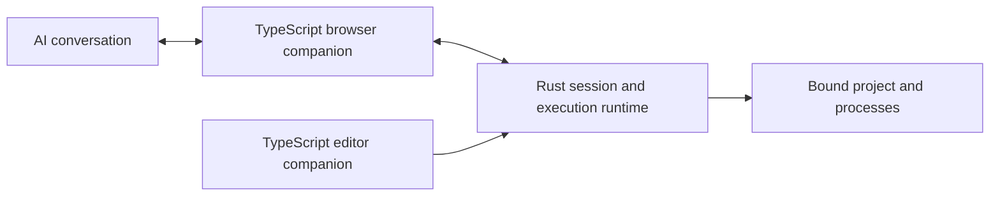

<div align="center">


# Relay

**Let your web AI work on your local project: safely, visibly, with receipts.**

Relay connects a Claude or ChatGPT conversation to a project open in VS Code or Cursor.<br>
The AI can read code, edit files and run checks, and you can see every action and its result.

[](LICENSE)
[](https://github.com/RiprLutuk/relay/releases/latest)
[](Cargo.toml)
[](apps)
[](package.json)
[](#quick-start)

[**Download**](https://github.com/RiprLutuk/relay/releases/latest) · [Quick start](#quick-start) · [Troubleshooting](#troubleshooting) · [Verification](docs/verification.md) · [Configuration](docs/configuration.md)

</div>

**Built with:** a **Rust** runtime (sessions, authorization, process execution), a **TypeScript** browser companion (Chrome, Brave, Edge) and a **TypeScript** editor companion (VS Code, Cursor), all shipped in one VSIX.

## How it works

1. **Install** one VSIX in your editor. It includes everything: the editor extension, the Rust runtime and the browser companion.
2. **Pair** the browser extension with your editor (one time only).
3. **Start a session** in a chat, pick a project, and just type your task.

You do not need to clone this repo, build anything or run `relayctl start`.

## Quick start

**You need:** VS Code or Cursor, and Chrome, Brave or Edge.

### 1. Download the package for your system

| OS | Download |
| --- | --- |
| Windows | [x64](https://github.com/RiprLutuk/relay/releases/download/v1.0.0/relay-workspace-1.0.0-win32-x64.vsix) |
| Linux | [x64](https://github.com/RiprLutuk/relay/releases/download/v1.0.0/relay-workspace-1.0.0-linux-x64.vsix) · [ARM64](https://github.com/RiprLutuk/relay/releases/download/v1.0.0/relay-workspace-1.0.0-linux-arm64.vsix) |
| macOS | [Intel](https://github.com/RiprLutuk/relay/releases/download/v1.0.0/relay-workspace-1.0.0-darwin-x64.vsix) · [Apple Silicon](https://github.com/RiprLutuk/relay/releases/download/v1.0.0/relay-workspace-1.0.0-darwin-arm64.vsix) |

> Windows and Linux packages are cross-built. Direct editor integration tests were run on macOS. See [verification](docs/verification.md).

### 2. Install it in your editor

In VS Code or Cursor, open **Extensions → ⋯ → Install from VSIX…** and select the file. Then open a local project folder you trust. Relay starts automatically.

### 3. Add the browser companion

1. Open the Command Palette (**Ctrl+Shift+P**, or **Cmd+Shift+P** on macOS) and run **Relay: Open Browser Extensions**. A folder opens.
2. In your browser, go to `chrome://extensions`, `brave://extensions` or `edge://extensions`.
3. Turn on **Developer mode**, click **Load unpacked**, and select the folder from the previous step.
4. Pin Relay to the browser toolbar.

### 4. Pair the browser with your editor

1. In the editor, run **Relay: Copy Pairing Token**.
2. Click Relay in the browser toolbar, paste into **Pairing token from your editor**, and click **Pair editor**.

Pairing is saved, so you only do this once.

### 5. Start your first session

1. Open a Claude or ChatGPT conversation, then open the Relay popup.
2. Select your **Project** and choose **Access for this conversation**.
3. Click **Start session**.

The popup should show **Ready** and list your project. Then type a task in the chat as usual. Try:

> **“List the main folders in this project and explain what it does.”**

Actions and results appear in the chat. Recent activity also shows in the popup and in **Relay: Open Control Center**.

## Daily use

1. Open your project and an AI conversation.
2. Select the project in Relay and click **Start session**.
3. Chat normally.
4. Click **Stop session** before switching to another project.

Each conversation keeps its own project, even if you switch editor windows. Pairing and browser installation are one-time steps.

## Access modes

| Mode | What the AI can do |
| --- | --- |
| **Workspace** | Files and commands are confined to your selected project. |
| **Full access** | Broader filesystem and process operations. Requires checking an approval box, and applies only to that conversation. |

Workspace mode is not an OS sandbox: project scripts and tools run as your user. Only open projects you trust. Details are in [SECURITY.md](SECURITY.md).

## Why it is reliable

- **Explicit targets:** a conversation is bound to the project you chose. Focus changes cannot redirect it.
- **Execution receipts:** retries with the same operation identity reuse the result, so actions are not run twice.
- **Visible lifecycle:** waiting, executing, returning, paused and failed are separate states. A connection alone does not mean the agent is running.
- **Clean cancellation:** closing the owning workspace invalidates its sessions and cancels running processes.
- **Local only:** the runtime listens on loopback and requires your pairing token.

## What has been tested

- **Claude** was verified live (file creation and read-back) in Brave on macOS.
- **ChatGPT** is covered by the browser integration fixture.
- **VS Code and Cursor** were verified with the packaged VSIX on macOS Apple Silicon.
- Profiles also exist for Gemini, DeepSeek, Kimi, GLM, Qwen, Arena, Meta AI, Ptero and Grok. They have not been verified live.

Full scope and limits are in [docs/verification.md](docs/verification.md).

## Troubleshooting

### The popup does not show Ready

Make sure a local project folder is open in your editor and that you completed pairing (step 4). Reload Relay on the browser's extensions page and refresh the AI tab.

### The session shows Session failed

The error message stays visible in the popup. Fix the cause, then click **Start session** again. Start also attaches Relay to an already-open chat if its agent is missing, so you do not need to reload the page.

### Updating Relay

1. Install the new VSIX from the [releases page](https://github.com/RiprLutuk/relay/releases/latest).
2. Run **Developer: Reload Window** in the editor.
3. Reload Relay on the browser's extensions page.
4. Refresh the AI tab and start a new session.

Pairing is kept unless the token changes. More details are in [docs/configuration.md](docs/configuration.md#updates).

### Re-pairing or rotating the token

Stop Relay, delete the token file at `~/.relay/bridge-token` (or under `RELAY_STATE_DIR`), restart, and pair again. Never paste the token into chat or Git.

## Architecture



The browser and editor companions are separate because they run in different hosts (browser DOM and Chrome APIs versus Node and VS Code APIs). Workspace routing, authorization and execution live in the Rust runtime. Capabilities are grouped by responsibility, for example `workspace.read`, `workspace.replace`, `project.test` and `process.run`.

## Contributing

Issues and pull requests are welcome. Please run `npm test` before opening a pull request, and report security problems privately as described in [SECURITY.md](SECURITY.md).

## Develop and package

Requires Rust/Cargo and Node 22.18+.

```sh
npm run setup
npm test
npm run package
```

`npm run package` creates a VSIX for your build machine's platform in `target/packages/`. Use `npm run package -- --target linux-x64` for one target, or `npm run package -- --all` for all five. Packaging validates binary architecture and writes `SHA256SUMS.txt`.

Install the matching Rust targets first. Linux builds use [cargo-zigbuild](https://github.com/rust-cross/cargo-zigbuild) and Zig with static musl binaries. Windows cross-builds use MinGW-w64, and native Windows builds use MSVC. macOS builds require the Apple SDK. These are maintainer tools; users only install the VSIX. Tests that launch a real browser are documented in [verification](docs/verification.md).

```text
apps/extension/src/          Browser domain, adapters, transport and presentation
apps/vscode-extension/src/  Editor registration, bootstrap and native controls
src/bin/bridge/             Workspace leases and execution journal
src/bin/workspace/          Process execution
scripts/                    TypeScript build, test and packaging tools
tests/                      Native and browser integration checks
```

Application source is TypeScript and Rust. JavaScript under `build/` and `out/` is generated. Files use kebab-case, functions use camelCase and types use PascalCase.

## License

GPL-3.0-or-later. Development history and upstream attribution are in [PROVENANCE.md](PROVENANCE.md).
