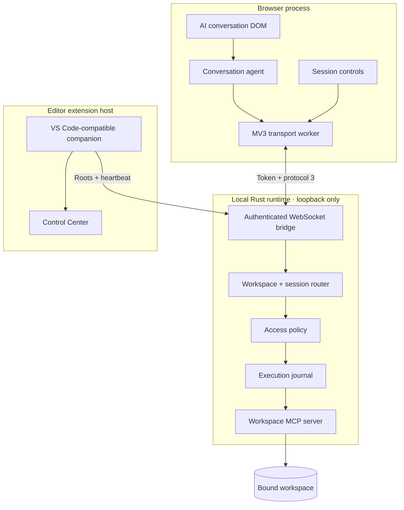
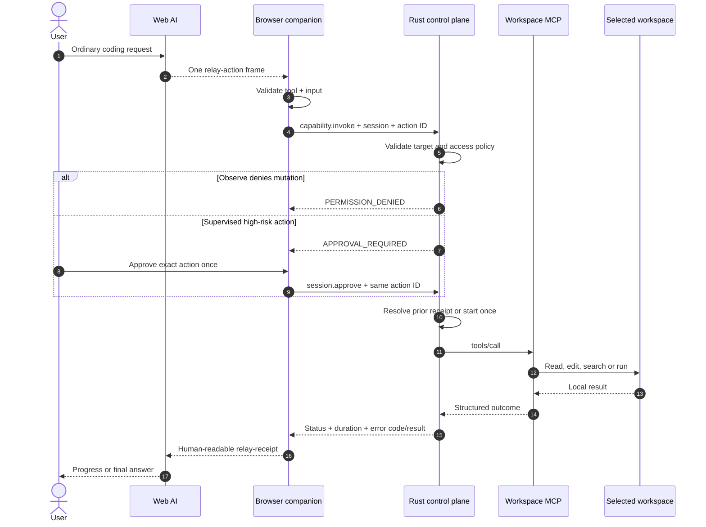

# Architecture

Relay is a local control plane shared by three isolated hosts. Browser code never receives direct filesystem access, and the editor extension does not parse AI output.

## Runtime topology

## One action, end to end

## Component ownership

| Component | Owns | Does not own |
| --- | --- | --- |
| Browser companion | Provider adapters, action parsing, session UI, visible receipts | Filesystem or process execution |
| Editor companion | Trusted root registration, runtime startup, health and activity | AI conversation parsing |
| Rust control plane | Authentication, immutable bindings, policy, deduplication, routing | Provider-specific DOM behavior |
| Workspace MCP | 25 bounded file, project, process, VCS and task capabilities | Browser/editor lifecycle |

## System invariants

- One conversation binds to one selected workspace for the lifetime of its session.
- Only an authenticated editor connection can register workspace roots.
- Tool names must come from the current session capability catalog.
- The same action identity cannot execute twice with different input.
- Uncertain destructive actions are never replayed automatically.
- Closing or changing the owning workspace invalidates its sessions.
- Observe is read-only; Supervised gates high-risk actions; confirmed Autonomous has full local access for that conversation.

See [protocol](protocol.md), [security](security.md), and [agent workflow](agent-workflow.md).
