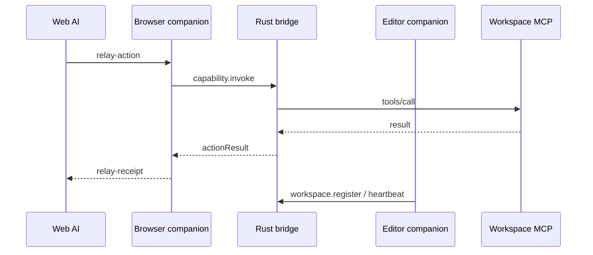

# Architecture

Relay is one product running in three hosts:

- `apps/extension`: provider adapters, conversation loop and browser transport.
- `apps/vscode-extension`: workspace registration, runtime lifecycle and Control Center.
- `src/bin/relay-bridge.rs`: authenticated sessions, routing, receipts and MCP processes.
- `src/bin/workspace-tools.rs`: the 24 local workspace capabilities.

Each editor window has its own identity and may register multiple roots. Each browser conversation binds one selected root to one native session. Focus changes cannot redirect that session.

See [protocol](protocol.md), [security](security.md), and [agent workflow](agent-workflow.md).
